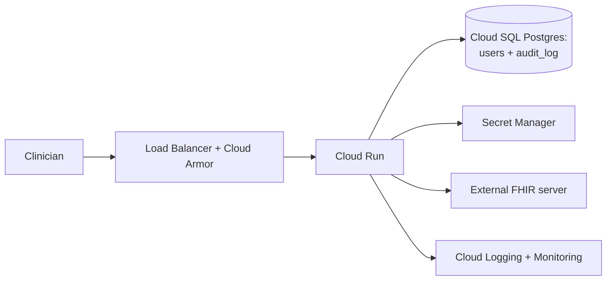

# Project plan

The single planning document for this project. Phases are numbered in the
order they should be built. Supersedes the previous per-phase files.

Last reviewed: 2026-08-09 · 286 tests passing, pyflakes clean.

- [1. Status](#1-status)
- [2. Renumbering](#2-renumbering)
- [3. Risk register](#3-risk-register)
- [4. Phase 4 — AI foundation](#4-phase-4--ai-foundation)
- [5. Phase 5 — Security hardening](#5-phase-5--security-hardening)
- [6. Phase 6 — Infrastructure and first deploy](#6-phase-6--infrastructure-and-first-deploy)
- [7. Phase 7 — Write-back foundation](#7-phase-7--write-back-foundation)
- [8. Phase 8 — Clinical actions](#8-phase-8--clinical-actions)
- [9. Phase 9 — AI clinical features](#9-phase-9--ai-clinical-features)
- [10. Phase 10 — Patient portal](#10-phase-10--patient-portal)
- [11. Phase 11 — Slainte-Scan integration](#11-phase-11--slainte-scan-integration)
- [12. Phase 12 — Public launch](#12-phase-12--public-launch)
- [13. Reference](#13-reference)
- [14. Gaps and innovations](#14-gaps-and-innovations)
- [15. Open decisions](#15-open-decisions)

---

## 1. Status

| Phases | Scope | State |
|---|---|---|
| 1–2 | Hardening, auth, audit log, FHIR client | **Done**, merged |
| 3 | Clinical usability, charts, password auth | **Done**, merged |
| 4 | AI foundation | **Done** — provider, context, prompts, de-identification, exchange trail |
| 5–12 | Everything below | Planned |

Phase 4 is the substrate only. Nothing in the app calls a model with patient
data yet: the buttons that do that are [Phase 9](#9-phase-9--ai-clinical-features),
after security ([5](#5-phase-5--security-hardening)) and deployment
([6](#6-phase-6--infrastructure-and-first-deploy)).

## 2. Renumbering

Phases were reordered so the numbering matches the build order. Three findings
forced it:

1. **Security before deployment.** Two live defects (per-worker rate limiting,
   random log salt) get *worse* on the deployment target. Deploying first means
   hardening in public.
2. **Migrate the database while it is small.** The Postgres migration touches
   every query in `db.py`. The schema is two tables today; write-back and AI
   each add more. Every phase deferred makes it bigger.
3. **Public page and deployment are one launch**, not two phases.

| New | Old | Phase |
|---|---|---|
| 4 | 4a-ii | AI foundation — finish the substrate |
| 5 | 7 | Security hardening |
| 6 | 8 + 10a | Infrastructure and first deploy |
| 7 | 5a | Write-back foundation |
| 8 | 6 | Clinical actions — diagnosis, prescribing |
| 9 | 4b–4d | AI clinical features |
| 10 | 5b | Patient portal |
| 11 | new | Slainte-Scan integration |
| 12 | 9 + 10b | Public launch — page, brand, domain |

Each phase below carries **Why**, a task checklist, technical notes, and a
**prompt** written to be handed to an agentic coding assistant. Prompts assume
the repo conventions: defensive FHIR parsing, failure-vs-empty semantics, audit
on every access, tests alongside code, no unpinned dependencies.

## 3. Risk register

| # | Risk | Likelihood | Impact | Mitigation |
|---|---|---|---|---|
| R1 | Postgres migration breaks the offline test suite | High | High | SQLite stays the test backend behind a connection layer. If CI needs Postgres for unit tests, it was done wrong |
| R2 | **Patient portal leaks another patient's record** | Medium | **Severe** | Resource-scoped authorization, not role-based. See [Phase 10](#10-phase-10--patient-portal) |
| R3 | CSP silently breaks the charts | High | Medium | Chart configs are inline `<script type="application/json">`. Needs a browser test, not a header assertion |
| R4 | Cloud SQL + Memorystore standing cost on an idle demo | High | Low | Price first; consider a Postgres-backed limiter instead of Redis |
| R5 | Slainte-Scan output not persistable as-is | Confirmed | Medium | LOINC codes and transaction bundle needed. See [Phase 11](#11-phase-11--slainte-scan-integration) |
| R6 | AI outruns the compliance gate on a real server | Medium | Severe | `AI_ALLOW_REAL_PHI` enforces this in code. Keep every AI route behind it |
| R7 | Write conflicts between two clinicians | Medium | High | `If-Match`; treat **409 and 412** as conflicts (HAPI returns 409) |
| R8 | Scope sprawl — twelve phases, one developer | High | Medium | Every phase ships something demonstrable. Thin vertical slices over complete layers |
| R9 | Demo server data changes underneath us | Medium | Low | Never hardcode patient IDs in tests; the suite is fully stubbed |

---

## 4. Phase 4 — AI foundation

**Status: done.** Nothing in the app sends patient data to a model yet — this
phase built the substrate that Phase 9's buttons will sit on.

**Why:** the provider layer existed but nothing consumed it. Building context
assembly, prompting, the de-identification pass and the exchange trail *before*
any user-facing feature means the safety properties are structural rather than
retrofitted onto a shipped button.

### Tasks

- [x] `ai/context.py` — `build_patient_context(fhir, patient_id)` via
      `GET /Patient/{id}/$everything`, falling back to `fhir.get_many()`
- [x] Tag every fact with its source `[ResourceType/id]` so citations are checkable
- [x] **Send the whole record by default.** Measured: a dense record is ~19K
      tokens against a 1,050,000 window. Curate only above a ceiling well under
      `AI_INPUT_TOKEN_CLIFF` (272K), never truncating allergies, and state in
      the prompt what was omitted
- [x] `build_section_context(fhir, patient_id, section)` for the narrow buttons
- [x] `ai/prompts.py` — versioned system prompts; context block **byte-identical**
      across turns so prompt caching hits (cached input is 10x cheaper)
- [x] De-identification pass, config-gated: strips name, address, contact.
      On by default the moment `FHIR_SERVER_URL` is not a demo server
- [x] `ai_exchange` table, append-only triggers like `audit_log`:

```sql
CREATE TABLE ai_exchange (
    id INTEGER PRIMARY KEY AUTOINCREMENT,
    occurred_at TEXT NOT NULL,
    actor TEXT NOT NULL,              -- username
    patient_ref TEXT NOT NULL,        -- pseudonymised
    feature TEXT NOT NULL,            -- 'chat' | 'summary' | 'section'
    model TEXT NOT NULL,
    prompt_hash TEXT NOT NULL,        -- sha256 of assembled prompt
    prompt_version TEXT,              -- added: which wording produced this
    deidentified INTEGER NOT NULL DEFAULT 0,
    input_tokens INTEGER,
    output_tokens INTEGER,
    response TEXT NOT NULL            -- full text, for later review
);
```

- [x] Tests with a `FakeProvider`; no network in CI

### What was built

| File | Contents |
|---|---|
| `ai/context.py` | `fetch_record` → `RecordFetch`; `build_patient_context`, `build_section_context` → `PatientContext`; curation, de-identification, `estimate_tokens` |
| `ai/prompts.py` | `PROMPT_VERSION`, shared safety rules + three features, `build_messages`, `cacheable_prefix`, `prompt_hash` |
| `db.py` | `ai_exchange` table with append-only triggers, `write_ai_exchange`, `read_ai_exchange` |
| `config.py` | `is_demo_fhir_host`, `deidentify_enabled`, `AI_DEIDENTIFY`, `AI_CONTEXT_TOKEN_CEILING` |

Tests: `test_ai_context.py`, `test_ai_prompts.py`, `test_ai_exchange.py` — 83
new, 286 total, offline. Verified against live HAPI: `$everything` resolves, a
real record renders, and two live fetches produce byte-identical text.

### Decisions taken while building

1. **Curation measures the rendered block, not the clinical lines.** Budgeting
   lines alone ignored section headings and the notes block, overshooting the
   ceiling by ~40% at small ceilings — an error pointing the unsafe way, since
   the ceiling exists to stay clear of the repricing cliff. It now renders,
   measures, and trims the measured overshoot, up to four passes.
2. **An unreadable section is never rendered as empty.** The fallback path
   marks failed reads `unavailable` and the block lists them under *Sections
   that could NOT be read*, with an instruction not to infer absence. This is
   the codebase's failure-vs-empty rule applied where it matters most: a
   clinician seeing a blank panel knows something may be missing; a model told
   a section is empty will state the patient has no allergies.
3. **`AI_DEIDENTIFY` is minimisation, not anonymisation.** Resource id tags stay
   so citations resolve, which means anyone with server access can re-identify.
   Documented as such in SECURITY.md rather than implied to be Safe Harbor.
   `AI_ALLOW_REAL_PHI` remains the control that decides anything.
4. **Free-text `note` elements are not rendered at all** — the one place a
   clinician's prose can name a third party, with no reliable way to strip it.
5. **Sort ties break on resource id.** Without it, two same-dated resources can
   swap places between calls, silently costing a prompt-cache hit every turn.
6. **`openai` pinned to `==2.53.0`** — it was the one unpinned dependency.

### Notes

`ai_exchange` is the record that lets someone investigate a bad answer after
the fact — non-negotiable before this touches a real patient. Cost is not a
constraint: ~$0.002/call, ~$2 per thousand. Reasoning effort, not context size,
is the cost lever (reasoning tokens bill at the output rate); default `low`.

**Carried into [Phase 9](#9-phase-9--ai-clinical-features):** routes must call
`context_options(app.config)` rather than re-deriving the de-identification
rule; every response must be written to `ai_exchange` before it reaches the
screen; and `PatientContext.complete` should be surfaced in the UI so a
clinician can see when an answer was formed from a partial record.

---

## 5. Phase 5 — Security hardening

**Why:** *secure by default* — a fresh clone deployed with the documented env
vars should already be defensible. Two of the findings below are live defects
that worsen on the Phase 6 deployment target.

### Findings (audited 2026-08-08)

| # | Finding | Severity |
|---|---|---|
| 1 | **Rate limiting is per-worker.** `memory://` storage with `--workers 3` means `10 per minute` is really 30; autoscaling multiplies it further | **High** |
| 2 | **`LOG_HASH_SALT` defaults to random per-process**, so pseudonymised IDs stop correlating across workers — the audit trail degrades silently | **High** |
| 3 | **No SRI on 3 of 4 CDN scripts** (Bootstrap, Chart.js, htmx). A compromised CDN runs arbitrary JS on a page showing patient data | **High** |
| 4 | **No security headers** — no CSP, `X-Frame-Options`, nosniff, `Referrer-Policy`, HSTS | Medium |
| 5 | `openai>=1.0.0` unpinned while everything else is `==` | Medium |
| 6 | No dependency scanning — no Dependabot, CodeQL or secret scanning | Medium |
| 7 | No hash-pinned lockfile | Low |

### Tasks

- [ ] Fix the per-worker limiter — error or loud warning on `memory://` with >1 worker
- [ ] Require `LOG_HASH_SALT` outside debug, exactly as `SECRET_KEY` is required
- [ ] SRI hashes on the three CDN tags, **or** vendor all four libraries into
      `static/` (decide first — it sets the CSP)
- [ ] `.github/dependabot.yml` — pip + github-actions, security updates ungrouped
- [ ] CodeQL workflow; enable secret scanning and push protection
- [ ] Pin `openai` exactly; add `pip-audit` to CI
- [ ] Security headers via one `after_request`
- [ ] Hash-pinned lockfile (`pip-compile --generate-hashes` or `uv lock`)
- [ ] Account lockout / progressive backoff per username — `login.denied` is
      already audited, so the signal exists
- [ ] Session invalidation test for a mid-session role downgrade
- [ ] SECURITY.md: move fixed items out of "Not in place"; add a threat model
      and a disclosure policy

### Notes

**Secure-by-default already true:** `SECRET_KEY` required outside debug,
`SESSION_COOKIE_SECURE` true, `HEALTH_SHOW_BACKEND` off, `AI_ALLOW_REAL_PHI`
off, new accounts land pending.

**Not in this phase:** SMART on FHIR / OIDC (Phase-7-sized work, not
hardening); encryption at rest (solved by the managed database in Phase 6);
penetration test (after deployment, or it tests the wrong thing).

> **Prompt:** *Harden the Flask FHIR dashboard, in this order. (1) Flask-Limiter
> defaults to `memory://` while the Dockerfile runs `--workers 3`, so the
> effective limit is 3x configured — make this a startup error or loud warning.
> (2) `LOG_HASH_SALT` defaults to random per-process, breaking pseudonymised-ID
> correlation across workers — require it outside debug exactly as
> `resolve_secret_key` requires `SECRET_KEY`. (3) Add Subresource Integrity to
> the three CDN script tags lacking it, or vendor the libraries into `static/`.
> Then add `.github/dependabot.yml`, a CodeQL workflow, `pip-audit` in CI, and
> security headers via a single `after_request`. The CSP must not break the
> inline `<script type="application/json">` chart config blocks — verify with a
> browser test that charts still render, not just that the header is present.*

---

## 6. Phase 6 — Infrastructure and first deploy

**Why:** **SQLite on Cloud Run destroys the user store and the append-only
audit log on every deploy.** Cloud Run gives each instance an ephemeral
filesystem and scales horizontally, so: every deploy discards all accounts, two
instances mean two divergent databases, and the compliance artifact the whole
design leans on evaporates. The append-only triggers make history unrewritable
*within* a file; they do nothing if the file disappears.

Deploy early so everything after ships continuously rather than in a big-bang
launch.

### What already fits

`Dockerfile` (non-root, healthcheck, gunicorn), `/health` and `/health/ready`
mapping onto startup and liveness probes, structured JSON logging that Cloud
Logging parses without an agent, and 12-factor config throughout.

### Target architecture



| Concern | Service |
|---|---|
| Compute | Cloud Run — scales to zero |
| Datastore | Cloud SQL Postgres — encryption at rest comes free |
| Secrets | Secret Manager — `SECRET_KEY`, `OPENAI_API_KEY`, `LOG_HASH_SALT`, DB password |
| Rate limits | Memorystore Redis, **or** a Postgres-backed limiter (see decisions) |
| Images | Artifact Registry |
| CI/CD | GitHub Actions → Cloud Run via Workload Identity Federation, not JSON keys |
| Observability | Cloud Logging, Monitoring, Error Reporting |

### Tasks

- [ ] Connection layer in `db.py`: SQLite for tests/dev, Postgres for
      production. Placeholder style differs (`?` vs `%s`) — touches every query
- [ ] Alembic, with the current schema as revision 1
- [ ] Port the append-only triggers, **and** grant the app role no
      `UPDATE`/`DELETE` on `audit_log` — immutability by privilege as well as trigger
- [ ] Read `$PORT` in the Dockerfile CMD (Cloud Run injects 8080)
- [ ] Artifact Registry, Cloud Run, Cloud SQL, Secret Manager
- [ ] Deploy on merge to `main` via Workload Identity Federation
- [ ] Monitoring alerts: 5xx rate, `login.denied` spikes, FHIR unreachable
- [ ] **Backup and restore drill** for Cloud SQL — an audit log you cannot
      restore is not an audit log
- [ ] Buy the domain; map to Cloud Run; managed TLS; HSTS once stable
- [ ] Seed demo data; publish a demo account
- [ ] Deploy smoke test against `/health/ready`, failing the pipeline on a bad rollout

### Demo account safety

A published login on a public URL is a standing invitation:

- Demo account is **viewer-role**, never clinician or admin
- `AI_ALLOW_REAL_PHI` stays false; backend stays the synthetic server
- No write routes reachable by it once Phase 7 lands
- Registration disabled or gated, or the user table fills with junk
- Consider resetting demo data on a schedule

### Notes

**Postgres, not Firestore** — the schema is relational, immutability is
enforced by SQL triggers, and `db.py` is already SQL. Firestore would mean
reimplementing immutability in application code, which is strictly worse for an
audit trail.

> **Prompt:** *Migrate the datastore from SQLite to Postgres without losing
> local test speed. Introduce a connection abstraction in `db.py` so SQLite
> remains the backend for the 203-test suite (in-memory, offline, no container)
> and Postgres is used in production. Normalise the parameter placeholder
> difference. Add Alembic with the existing schema as revision 1. Port the
> `audit_log` append-only triggers to Postgres and additionally restrict the
> application role so it cannot UPDATE or DELETE that table. Add one CI job on
> a Postgres service container asserting the immutability guarantee
> specifically, since that is the behaviour whose enforcement mechanism changes
> between backends. Do not make the unit suite depend on Postgres.*

---

## 7. Phase 7 — Write-back foundation

**Why:** the app is a viewer. This is where it becomes a system clinicians
chart into — and it unblocks Phases 8, 10 and 11.

### Tasks

- [ ] `FhirClient.post(resource_type, body)` and
      `put(resource_type, id, body, if_match=None)`, reusing the existing
      timeout/retry/pseudonymised-logging path. No second HTTP code path
- [ ] Version-conflict handling: treat **409 and 412** as conflicts (the spec
      says 412; HAPI returns 409 — verified live), surfaced as "this record
      changed since you opened it," never a generic error
- [ ] `resource_edit_log` table, append-only, before/after JSON:

```sql
CREATE TABLE resource_edit_log (
    id INTEGER PRIMARY KEY AUTOINCREMENT,
    occurred_at TEXT NOT NULL,
    actor TEXT NOT NULL,
    resource_type TEXT NOT NULL,
    resource_id TEXT NOT NULL,   -- pseudonymised
    action TEXT NOT NULL,        -- 'create' | 'update'
    before_value TEXT,           -- JSON, null for create
    after_value TEXT NOT NULL
);
```

- [ ] Condition write-back as the reference implementation, following:

```
GET  /fhir/Conditions/<pid>/new        -> form
POST /fhir/Conditions/<pid>            -> validate, POST, audit, re-render
GET  /fhir/Conditions/<pid>/<id>/edit  -> form pre-filled, carrying the ETag
PUT  /fhir/Conditions/<pid>/<id>       -> validate, PUT with If-Match, audit
```

- [ ] Server-side validation before the FHIR call; the server's own validation
      is the backstop, not the first line
- [ ] Role-gated to clinician/admin. Viewers never see the control **rendered** —
      a rendered-but-403'd button is worse UX than one that is absent
- [ ] A diff view over `resource_edit_log` — small addition, demonstrates the
      audit design working

### Notes

Optimistic concurrency, not locking: nothing stops a second editor *opening* a
record, only silently overwriting a conflicting edit. Roughly a week's work,
most of it the conflict UI and tests rather than the HTTP calls.

> **Prompt:** *Add write support to `FhirClient`: `post(resource_type, body)`
> and `put(resource_type, id, body, if_match=None)`, reusing the existing
> timeout, retry and pseudonymised-logging path — do not create a second
> HTTP-calling code path. `put` requires an ETag and must treat both HTTP 409
> and 412 as version conflicts (HAPI returns 409 for a stale `If-Match`,
> verified 2026-08-08). Add an append-only `resource_edit_log` recording actor,
> resource, action and before/after JSON. Implement Condition create/edit as the
> reference write route, role-gated to clinician and admin, with the control
> hidden — not merely 403'd — for viewers. Include a test that two sequential
> edits from stale data produce a surfaced conflict.*

---

## 8. Phase 8 — Clinical actions

**Why:** diagnosis first, then prescribing. Diagnosis is the data-heavy step —
made *in the context of* previous diagnoses, medications and allergies, all of
which the app already fetches — and the prescription workflow wants a diagnosis
to point at via `reasonReference`. Each step produces the reference the next one
consumes, so nothing ever writes a dangling reference.

### 8.1 Diagnosis (Condition write)

- [ ] Diagnosis context panel — previous diagnoses, active medications,
      allergies, latest observations, side by side. Data questions before data entry
- [ ] Duplicate guard — on code selection, warn "already on the problem list
      (active, onset 2020)" instead of silently adding a twin
- [ ] Condition form — code search (ICD-10-CM + SNOMED), clinical status,
      verification status (`provisional` vs `confirmed` — real diagnoses start
      provisional), onset date, note
- [ ] Edit/resolve flow with before/after in `resource_edit_log`
- [ ] Clinician/admin only; viewers never see the form

### 8.2 Prescription (MedicationRequest write)

- [ ] **Prescriber identity decision** — `requester` should reference a
      Practitioner, and app accounts are not Practitioners. Map users to
      Practitioner resources, or record a display-only string. Decide first
- [ ] Medication picker — RxNorm-coded, free-text fallback
- [ ] **Allergy hard-stop** — cross-check AllergyIntolerance before submit; a
      match blocks with an explicit override plus reason, and the override is audited
- [ ] Dosage builder — structured `dosageInstruction` plus the free-text sig line
- [ ] `reasonReference` → the Condition from 8.1
- [ ] Status lifecycle: active → completed/stopped with reason; renewals clone
      rather than edit history
- [ ] Printable prescription

### 8.3 Close behind

Clinical notes (`DocumentReference`), encounter creation tying a sitting
together, `Task` recall follow-ups, immunizations and procedures (same
read-only pattern as medications — near-free), unified patient timeline,
printable IPS summary, saved cohorts.

**Drug-interaction checking** needs an external interactions source, outside
FHIR's scope — scope it before promising it.

> **Prompt:** *Build the diagnosis workflow on the Phase 7 write infrastructure.
> Start with a context panel showing previous diagnoses, active medications and
> allergies together — the clinical questions come before the form. Add a
> Condition form with ICD-10-CM and SNOMED code search, clinical and
> verification status (defaulting to provisional), onset date and a note. Before
> submit, check the patient's existing Conditions for the same code and warn
> rather than silently creating a duplicate. Use `FhirClient.post`/`put` with
> If-Match, treating 409 and 412 as conflicts, and record before/after in
> `resource_edit_log`. Role-gate to clinician and admin.*

---

## 9. Phase 9 — AI clinical features

**Why:** the substrate from Phase 4 now has grounded, clinician-authored data
to work on.

### Buttons

Button posts a section identifier, server builds a context scoped to *only*
that section, response streams into a panel beneath it via SSE (htmx SSE
extension — keeps the no-JS-framework architecture).

| Placement | Button | Priority |
|---|---|---|
| Patient card | Summarise this patient | 1 |
| Allergies card | **Cross-check against medications** | 1 — the one genuine safety check; both datasets already fetched |
| Conditions card | Explain this problem list | 2 |
| Lab results | Interpret results | 2 |
| Vital signs | Assess trend | 2 |
| Medications | Review medications | 2 |
| Demographics | Explain this cohort (aggregates only) | 3 |
| Global dock | Ask about this patient (multi-turn) | 1 |

Dropped: the per-patient-row "Quick take". At 20 calls per page render it is a
latency problem, and it was the weakest item on the list.

### Tasks

- [ ] `/ai/summarise/<section>/<patient_id>` — one-shot section button
- [ ] `/ai/chat/<patient_id>` — multi-turn, SSE
- [ ] Both `@auth.require_role(ROLE_CLINICIAN, ROLE_ADMIN)` — explicitly not viewers
- [ ] Every response carries "AI-generated — verify before acting", model name
      and timestamp
- [ ] Cache per FHIR resource version — unchanged data, no re-call
- [ ] Every exchange written to `ai_exchange`

### Guardrails

In the system prompt, enforced by instruction not code — stated honestly rather
than overclaimed:

- **Grounding** — answer only from the context; if absent, say so; never infer
- **Citation** — every clinical claim carries its `[ResourceType/id]`
- **Role boundary** — decision support for a qualified clinician. Never a
  diagnosis, never a prescribed dose
- **Uncertainty** — stale, missing or contradictory data is named, not smoothed
- **Negative findings** — "no allergies recorded" and "allergies not retrieved"
  must never collapse into one sentence. This is the distinction Phase 1 fixed
  at the HTTP layer; the AI layer must not quietly undo it. Phase 4 made the
  input side structural — the context block lists unreadable sections
  separately from empty ones — so the prompt rule now has something true to
  rest on rather than being the only defence

### Compliance gate

Governs *when* this is safe against real data: a BAA (US) or processor
agreement plus DPIA (UK/EU) before any real PHI reaches a provider; verify
zero-retention terms apply to the account tier; de-identification on by default
outside the demo server. `AI_ALLOW_REAL_PHI` already enforces the last part in
code.

---

## 10. Phase 10 — Patient portal

**Why:** patients seeing their own record, connecting to the clinician
dashboard. Read-only MVP.

### What the server can actually show

Checked live 2026-08-09:

| Resource | Count | Portal use |
|---|---|---|
| Encounter | 12,171 | Visit history |
| Appointment | 2,391 | Upcoming and past |
| ServiceRequest | 2,173 | Referrals to specialists |
| Procedure | 2,072 | Treatment history |
| DocumentReference | 1,078 | Letters, written advice |
| Condition | 2,951 | Conditions being managed |
| MedicationRequest | 1,418 | Current medications |
| CarePlan | 104 | Care plan |
| Goal | 3 | **effectively absent** |
| NutritionOrder | 1 | **effectively absent** |

**Consequence:** conditions, medications, appointments, letters and history all
have real data. **Diet advice and goals do not** — they must be *authored* by a
clinician (a write, via Phase 7) and then shown read-only. Do not plan a diet
screen that reads existing data; there is none.

### Tasks

- [ ] My conditions, medications (with `reasonReference` for *why*),
      appointments, documents
- [ ] My history — merged encounters and procedures timeline
- [ ] Diet and lifestyle advice — clinician-authored, read-only
- [ ] **My access log** — who viewed my record and when, straight from
      `audit_log`. Nearly free, and unusually trust-building

### Deliberately excluded

Patients editing clinical resources. A patient-asserted condition is not a
diagnosis, and merging the two corrupts the problem list. Model patient input as
`QuestionnaireResponse` or `Communication` for clinician review.

### The authorization problem — read before building

**Risk R2, the most dangerous item in the plan.** The current model is
role-based: `require_role` asks *what kind of user is this*. A portal needs
**resource-scoped** authorization: *may this user read this specific record*. A
clinician may read any patient; a patient may read exactly one.

- A `patient` role that is **not** a lesser `viewer` — viewers read every
  patient, precisely the wrong default here
- A server-side, verified binding account → `Patient/{id}`, never self-asserted
- Every route resolves the patient ID **from the session binding, not the URL**.
  A route trusting a URL parameter is a full record breach one edit away
- Tests asserting patient A gets 403 for patient B on *every* route

> **Prompt:** *Add a read-only patient portal. The critical constraint is
> authorization: the existing `require_role` decorator is role-based, but a
> patient must read exactly one record — their own. Add a `patient` role plus a
> verified server-side binding from user account to `Patient/{id}`, and a
> decorator that resolves the patient ID **from the session binding, never from
> the URL**. Every portal route must use it. Write tests asserting a patient
> account receives 403 for any other patient's data on every route, mirroring
> `TestAuthorization` in `tests/test_routes.py`. Show conditions, medications,
> appointments, documents, a merged history timeline, and the patient's own
> access log from `audit_log`. Patients must not write clinical resources.*

---

## 11. Phase 11 — Slainte-Scan integration

**Why:** [slainte-scan-mcp](https://github.com/daveymason/slainte-scan-mcp)
digitises handwritten A&E triage notes into IE Core FHIR R4. Same language,
same FHIR version, same cloud (`europe-west1`). Its triage categories come from
a deterministic rules engine rather than a model, and its response demands human
approval — both match this project's stance that software surfaces and
clinicians decide.

**Interface:** one FastMCP tool over SSE, API-key authenticated —
`ingest_handwritten_note(image_bytes: bytes) -> dict` returning
`{fhir_bundle, assigned_triage_category, requires_human_approval, message}`.
Honour `requires_human_approval` literally: never auto-persist.

### Blockers (assessed against `main`, 2026-08-09)

| Gap | Effect | Fix side |
|---|---|---|
| Observations carry `CodeableConcept(text=…)` with **no LOINC coding** | This dashboard searches Observations *by LOINC code*, so scanned vitals would never appear in the Vital Signs panel. **The single biggest blocker** | Slainte-Scan — add 8480-6, 8462-4, 8867-4, 2708-6/59408-5 |
| Bundle `type` is `collection` | Cannot be POSTed to persist; needs `transaction` with per-entry `request.method`/`url` | Slainte-Scan |
| No `effectiveDateTime` on Observations | Undated readings sink to the bottom of tables and plot no chart points | Slainte-Scan |
| Patient `id` hardcoded `"1"` | Persisting needs a conditional create keyed on the GMS identifier (`urn:oid:1.3.6.1.4.1.54392.5.2690.42.80`) | Both |
| `image_bytes: bytes` over JSON-RPC | Needs base64; confirm FastMCP handling and payload limits | Both |
| SSE transport | Superseded by Streamable HTTP in the current MCP spec — maintenance risk, not a blocker | Slainte-Scan |

### Tasks

- [ ] An MCP client — the app has none today; the main cost of this integration
- [ ] Triage intake screen: upload → call tool → show extracted vitals and MTS
      category → **clinician approves or corrects** → persist
- [ ] Patient matching by GMS identifier including the Irish OID
- [ ] Display the MTS category; record the approval in `resource_edit_log`

Small-to-medium **once Phase 7 exists**, near-impossible before it. The LOINC
fix on the Slainte-Scan side is a handful of lines and unlocks the display path.

---

## 12. Phase 12 — Public launch

**Why:** a product-style landing page, a professional brand, and a live demo to
point at.

### Audiences

1. **A hiring manager or technical lead** skimming for 60 seconds — wants to
   know what it is, that it's real, and that the judgement is sound
2. **A developer** who might read the code — wants architecture and decisions
3. **A clinician** — wants to see the screens and understand honestly what it
   is and isn't

### Honesty constraints — non-negotiable

A page about a patient dashboard that overstates itself damages credibility
with exactly the audience it targets.

- State plainly it is a **demonstration** against **synthetic** data
- **No** invented users, testimonials, certifications or metrics. Real,
  checkable numbers only
- **No** medical-device or clinical-validation language
- Link SECURITY.md including its gap list — identified gaps read as competence
- Domain and branding make a project look more official, which *raises* the
  duty to be clear about what it is

### Content

Hero (one sentence, real screenshot) · the problem (FHIR tools are either
enterprise-heavy or toys; this sits between) · live screens · architecture
(Flask + HTMX, no build step, fragments over the wire, concurrent fetches,
append-only audit) · **engineering decisions** — the section a technical reader
stops for:

- An unreachable backend must never render as "no allergies recorded" — a
  failure and an empty result are clinically different
- Blood pressure arrives in two shapes from real servers; both handled,
  unpairable readings dropped rather than guessed
- The audit log is append-only by database trigger, not convention
- AI is gated in code on the data source being synthetic

Then the phase journey, and links.

### Brand

Credibility here comes from restraint. One accent colour used sparingly,
generous whitespace, a deliberate typeface pairing, tabular figures for clinical
numbers, real screenshots, no stock photography. The current `--tropical-*`
palette in `static/styles.css` reads as a tutorial theme and should be replaced.
**Apply the identity to the app, not just the page** — a polished landing page
in front of an unstyled app is worse than neither.

### Specialty personas — dentist, GP, psychiatrist

Same app and layout, different cohort and panel emphasis, implemented as a
**specialty profile**: config selecting which panels lead, which terminology
subset the picker uses, which demo cohort loads. Demonstrates a platform rather
than one hard-coded screen, and exercises real FHIR design — specialty
differences genuinely live in `Condition.category`, `Procedure.bodySite` and
terminology bindings. **One excellent persona at launch beats three thin ones.**

### Tasks

- [ ] Landing page — hand-written static HTML/CSS, self-contained, no CDN
- [ ] Screenshots at a consistent viewport against synthetic data
- [ ] Architecture diagram; Open Graph tags (most of how a link gets seen)
- [ ] Accessibility pass — semantic headings, real alt text, keyboard nav,
      contrast. Note the invisible panel headings fixed in Phase 4 were a
      contrast failure that shipped
- [ ] Link page → live demo with visible credentials
- [ ] Rate limits sized for a public demo, assuming abuse

---

## 13. Reference

### 13.1 Verified platform facts

**FHIR server** (`https://hapi.fhir.org/baseR4`, checked 2026-08-08):

| Capability | Result |
|---|---|
| `GET /Patient/{id}/$everything` | Works — Patient + Encounter + Observations in one call |
| `POST Condition` | 201 with ETag `W/"1"` |
| `PUT` with `If-Match` | 200, version increments |
| `PUT` with stale `If-Match` | **409**, not the spec's 412 — handle both |
| `DELETE Condition` | 200 |

**Clinical data profile:** 2,951 Conditions (ICD-10-CM 39%, SNOMED 34%,
ICD-10 11%); `clinicalStatus` on 68%, `onsetDateTime` 44%, `recordedDate` 21% —
every field is optional in practice. Encounter linkage is weak (18% of
Conditions, 1% of MedicationRequests) so **do not build anything requiring an
encounter**. 1,418 MedicationRequests, `dosageInstruction` on 82%, RxNorm
dominant. 605 Practitioners.

**Model** (`gpt-5.6-luna`, confirmed 2026-08-08):

| Property | Value |
|---|---|
| Context / max output | 1,050,000 / 128,000 tokens |
| Pricing | $0.20/M input · $0.02/M cached input · $1.20/M output |
| Repricing cliff | >272K input → 2x input, 1.5x output on the whole request |
| Endpoints | `v1/chat/completions` and `v1/responses`; streaming supported |
| Reasoning | `none`/`low`/`medium`/`high`/`xhigh`/`max`; tokens bill as output |

Measured context: a dense patient record is ~19,300 tokens (~$0.0039); a
curated subset ~3,800. Roughly **$2 per thousand calls**. Not yet exercised with
live credentials — the settings page check will confirm the model resolves.

### 13.2 Conventions

Defensive FHIR parsing (every function returns None/fallback rather than
raising); failure and empty are distinct at the type level (`FhirResult`); audit
on every patient access with pseudonymised identifiers; tests alongside code,
offline and stubbed; no unpinned dependencies; controls hidden rather than
rendered-then-403'd.

---

## 14. Gaps and innovations

| # | Gap | Why it matters |
|---|---|---|
| G1 | No backup/restore plan | An audit log you cannot restore is not an audit log. Folded into Phase 6 |
| G2 | No data-retention policy | `audit_log` and `ai_exchange` grow unbounded — cost and compliance |
| G3 | No error tracking | Logs exist; nothing aggregates or alerts. Cheap in Phase 6 |
| G4 | No accessibility audit | A clinical tool carries a stronger obligation, and UK/EU public sector has legal requirements |
| G5 | No performance budget | Every panel is a live FHIR round trip. A slow demo reads as broken |
| G6 | No ADR log | Decisions live in commit messages and this file |
| G7 | **Terminology source unplanned** | Phase 8 needs ICD-10/SNOMED search. Bundled subset, `$expand` on the server, or external service — **decide before Phase 8** |
| G8 | No degraded mode | If the FHIR server is down the app is a shell. A public demo needs graceful degradation |
| G9 | Single points of failure in the demo | Consider a read-through cache so a HAPI outage doesn't blank it |
| G10 | **`ai_exchange` has no reader in the app** | The trail is written but only reachable via SQLite. `/admin/audit` has no AI equivalent, so an investigation needs shell access to the box. Small admin page — fold into Phase 9 |
| G11 | Token counts are estimated, not reported | `estimate_tokens` is a character heuristic; the provider returns real usage. Phase 9 should store the reported counts and keep the estimate only for the pre-flight ceiling check |

### Innovations worth taking

- **Lead with the clinical safety net.** The allergy-vs-medication cross-check
  is the one item with genuine clinical value rather than convenience.
- **Make the audit log a visible feature.** "Every access recorded, immutably"
  is a differentiator here. Giving patients their own access log is cheap and
  unusually trust-building.
- **Structured outputs** for anything parsed, rather than free text — removes a
  class of parsing bug.

### The smart toilet / fridge idea

Honestly, that is **a different product** — consumer IoT and nutrition
tracking, against a clinician-facing record viewer. Forcing them together
weakens both.

The right relationship is that the consumer app becomes a **client** of this
one through the patient portal, writing `Observation` resources (weight, diet
adherence) into the patient's record that the clinician then sees. Clean
boundary, and a genuinely compelling story — patient-generated data flowing into
the clinical record — without entangling the codebases. Prerequisite: Phase 10
plus a patient-scoped write API. Keep in view as a possible Phase 13.

---

## 15. Open decisions

1. **Terminology source** for Phase 8's code pickers (G7) — blocks Phase 8
2. **Single-practice or multi-tenant** — decide before appointments/billing
3. **Landing page hosting** — GitHub Pages (stays up if the app is down) vs
   served by the app (one deployment, one domain)
4. **Memorystore or a Postgres-backed rate limiter** — cost against correctness
5. **Retention windows** for `audit_log` and `ai_exchange` (G2) — now live
   rather than hypothetical: the table exists and is append-only, so a
   retention policy has to be a scheduled job, not a `DELETE`
6. **How many demo personas at launch** — one strong or three thin
7. **Prescriber identity** — map users to `Practitioner`, or display-only string
8. **CDN or vendored assets** — vendoring simplifies CSP considerably
9. **Domain name** — must not imply a real clinical service
10. **Retention of `ai_exchange.response`** — indefinite audit value vs storage
