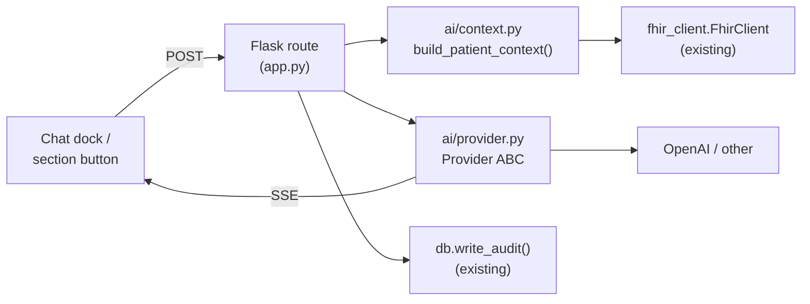

# Phase 4 — AI

Status: **planned, not started**. This document is the implementation plan; no
code in this phase has been written yet. Entry criteria live in
[pre-phase-4-checklist.md](pre-phase-4-checklist.md) — the bug/UX items there
are fixed, the open decisions (key scope, `SECRET_ENCRYPTION_KEY`, compliance
posture, AI spend limits) are not. It supersedes the ad-hoc
`/summarize_patient/<id>` route on the stale `feat/ai-patient-summary` branch
(see [Superseding the existing AI branch](#superseding-the-existing-ai-branch)).

## Scope

Everything that sends patient data to a language model and shows the response
back to a clinician: a multi-turn chat scoped to one patient, and a set of
narrow "summarise / interpret / cross-check" buttons on individual panels. No
write-back to FHIR happens in this phase — that's [Phase 5](phase-5-management-plan.md).

## What Phase 4 builds on

Already in place from Phases 1–3, load-bearing for this phase:

| Existing piece | Where | Why it matters here |
|---|---|---|
| `FhirClient` with timeouts/retries/concurrency | `fhir_client.py` | The context builder is just another consumer of this |
| Role model (`admin`/`clinician`/`viewer`) | `auth.py`, `db.py` | AI features gate on `clinician`+, not `viewer` |
| Append-only audit log | `db.py` (`write_audit`/`read_audit`) | Every AI exchange must land here — see [Audit trail](#audit-trail) |
| Pseudonymised logging | `logging_setup.py` | The same `pseudonymize()` helper applies to AI request logs |
| CSRF (Flask-WTF) + rate limiting (Flask-Limiter) | `app.py` | Chat and button endpoints need both — LLM calls are exactly the kind of expensive-per-request endpoint rate limiting exists for |
| AI Settings page | `templates/ai_settings.html`, `/test_openai_key` | Currently tests a key and discards it — Phase 4 replaces this with real storage |

### Superseding the existing AI branch

`origin/feat/ai-patient-summary` (authored by `google-labs-jules[bot]`, June
2025) adds a single `/summarize_patient/<patient_id>` route that fetches
demographics + conditions, builds a prompt inline in the route handler, and
calls OpenAI directly. It forked before the Phase 1/2 hardening — merging it
as-is would delete `auth.py`, `db.py`, `config.py`, `fhir_client.py`, and the
whole `tests/` directory.

**Action: close that PR without merging** once Phase 4 lands. Its one feature
(patient summary) is reimplemented properly below as the first AI button, with
context management, audit logging, and role-gating the original never had.

## Architecture

Five pieces, built in dependency order. Each is a new module; nothing here
belongs in `app.py` directly beyond the routes that call into them.



### 1. `ai/context.py` — context builder

`build_patient_context(patient_id, sections) -> PatientContext`

- Fetches via `GET /Patient/{id}/$everything` where the server supports it
  (confirmed supported on the HAPI instance this app defaults to), falling
  back to the existing per-resource-type calls through `fhir.get_many()`
  otherwise.
- Every fact is tagged with its source: `[MedicationRequest/1234]`. This is
  what makes citation checking possible later — see [Guardrails](#guardrails).
- Token budget: most recent 20 observations, active medications only, **all**
  allergies never truncated, most recent 10 conditions. Sorted newest-first,
  truncated from the bottom; the prompt states what was omitted so the model
  can say "I only have the last 20 results" instead of implying completeness.
- Section-scoped variant: `build_section_context(patient_id, section)` for
  the narrow buttons (e.g. `section='allergies_and_medications'` fetches only
  those two resource types) — smaller context, cheaper call, less surface for
  the model to wander into.

### 2. `ai/prompts.py` — prompt assembly

- One stable system prompt per feature (chat vs. each button), versioned by a
  constant so a prompt change is a one-line diff, not a hunt through route code.
- Structure: system prompt → context block → conversation history → question.
  Keep the system prompt and context block **byte-identical** across turns of
  the same conversation so provider-side prompt caching can hit.
- De-identification pass (optional, config-gated): strips name, address, and
  contact details from the context block before it leaves the process. Off by
  default against the demo HAPI server; **on by default** the moment
  `FHIR_SERVER_URL` points anywhere real — see [Compliance](#compliance-gate).

### 3. `ai/provider.py` — provider abstraction

```python
class Provider(Protocol):
    def stream_chat(self, messages: list[dict], **kwargs) -> Iterator[str]: ...
```

- `OpenAIProvider` is the only implementation initially (the app already
  depends on `openai>=1.0.0`), but the interface exists from day one so a
  provider swap is a config change, not a rewrite. The model name (currently
  hardcoded as `gpt-4.1-nano-2025-04-14` in the key-test route) moves to
  `Config.AI_MODEL`.
- Key retrieval goes through this layer too — see [Key storage](#key-storage).

### 4. Routes (in `app.py`, thin — orchestration only)

| Route | Method | Purpose |
|---|---|---|
| `/ai/chat/<patient_id>` | POST | Multi-turn chat, Server-Sent Events response |
| `/ai/summarise/<section>/<patient_id>` | POST | One-shot section button (see table below) |
| `/ai/settings` | GET/POST | Replaces the current key-test-only page |

Both AI routes require `@auth.require_role(db.ROLE_CLINICIAN, db.ROLE_ADMIN)` —
this is explicitly **not** available to `viewer` accounts.

Streaming: SSE via a generator response (`text/event-stream`), consumed on the
frontend with the [htmx SSE extension](https://htmx.org/extensions/sse/) —
keeps the "no JS framework" architecture intact, same pattern the rest of the
app already uses for HTMX fragments.

### 5. Audit trail

Every exchange is written via the existing `db.write_audit()`, extended with
one new table:

```sql
CREATE TABLE ai_exchange (
    id            INTEGER PRIMARY KEY AUTOINCREMENT,
    occurred_at   TEXT NOT NULL,
    actor         TEXT NOT NULL,          -- username
    patient_ref   TEXT NOT NULL,          -- pseudonymised, like audit_log
    feature       TEXT NOT NULL,          -- 'chat' | 'summarise' | ...
    model         TEXT NOT NULL,
    prompt_hash   TEXT NOT NULL,          -- sha256 of the assembled prompt
    input_tokens  INTEGER,
    output_tokens INTEGER,
    response      TEXT NOT NULL           -- full text, for later review
);
```

Same append-only trigger pattern as `audit_log` in `db.py`. This is the record
that lets someone investigate a bad answer after the fact — non-negotiable
before this touches a real patient, not a nice-to-have.

### Key storage

Today: `/test_openai_key` accepts a key, calls `openai.OpenAI(api_key=...).models.list()`,
and discards it. Phase 4 replaces this with:

- A `secrets` table (user-scoped or practice-scoped — see [open decision
  below](#open-decisions)) holding an encrypted key, using `cryptography`'s
  `Fernet` with a key derived from a new required env var, `SECRET_ENCRYPTION_KEY`
  (separate from `SECRET_KEY`, which signs sessions — a leaked session key
  must not also decrypt stored API keys).
- The key never round-trips to the browser after initial entry. The settings
  page shows a masked placeholder, not the value.
- `openai_settings.html`'s input is already `type="password"` (fixed in Phase
  3's template cleanup); it now actually persists.

## Guardrails

These live in the system prompt (`ai/prompts.py`), enforced by instruction, not
code — flag this honestly rather than overclaiming enforcement:

- **Grounding.** "Answer only from the PATIENT CONTEXT below. If the answer is
  not present, say so explicitly. Never infer a value that is not shown."
- **Citation.** Every clinical claim carries its `[ResourceType/id]` tag.
  Un-tagged sentences are the reviewer's signal the model went off-context —
  worth a lightweight regex check in tests (`test_ai_prompts.py`) that a
  canned response contains at least one citation per clinical claim, as a
  smoke check, not a guarantee.
- **Role boundary.** Decision support for a qualified clinician — summarise,
  surface, flag. Never a diagnosis, never a prescribed dose.
- **Uncertainty.** Stale, missing, or contradictory data is named, not smoothed
  over.
- **Negative findings.** "No allergies recorded" and "allergies not retrieved"
  must never collapse into the same sentence — this is the same distinction
  Phase 1 fixed at the HTTP layer for the Allergies panel; the AI layer must
  not quietly undo it.

## AI buttons

One pattern throughout: button posts a section identifier, server builds a
context scoped to *only* that section, response streams into a panel beneath
it via SSE.

| Placement | Button | Context sent | Priority |
|---|---|---|---|
| Patient card header | Summarise this patient | Demographics, conditions, active meds, allergies, last 10 observations | 1 — highest value, build first |
| Allergies card | Cross-check against medications | Allergies + active medication requests | 1 — the one genuine safety check, both datasets already fetched |
| Conditions card (new in Phase 3) | Explain this problem list | All conditions, onset-sorted | 2 |
| Lab Results card | Interpret results | Observations with reference ranges + age/sex | 2 |
| Vital Signs card | Assess trend | All vitals, chronological (same data the Phase 3 charts already use) | 2 |
| Medications card | Review medications | Meds + conditions + allergies | 2 — duplicate therapy, gaps vs. problem list |
| Patient list row | Quick take (icon) | Demographics + condition count only | 3 — rate-limit carefully, fires per row |
| Demographics footer | Explain this cohort | Aggregate counts only, no identifiers | 3 |
| Global dock | Ask about this patient | Full context, multi-turn | 1 — the chat itself |

Buttons render as **outline/secondary** style, never competing visually with
clinical data. Every AI response carries a persistent "AI-generated — verify
before acting" label plus model name and timestamp. Cache per FHIR resource
version: if nothing changed since the last answer, don't re-call the model.

## Compliance gate

Restated from the earlier review — this governs *when* Phase 4 is safe to
point at real data, not just how it's built:

- A Business Associate Agreement (US) or processor agreement + DPIA (UK/EU)
  with the model provider, before any real PHI reaches it.
- Verify the provider's zero-retention terms apply to the account tier in use.
- De-identification pass (see [Prompt assembly](#2-aiprompts.py--prompt-assembly))
  turned on by default outside the demo server.
- `SECURITY.md` gets a new section for this once Phase 4 lands.

## Open decisions

Things this plan cannot resolve without input:

1. **Key scope** — one API key per user, or one per practice (shared across
   all clinicians at an organisation)? Affects the `secrets` table schema.
2. **Cost controls** — per-user or per-practice rate/spend caps beyond the
   existing Flask-Limiter request-rate limiting?
3. **Retention** — how long does `ai_exchange.response` live? Indefinitely (audit
   value) vs. a retention window (storage/compliance tradeoff).
4. **De-identification scope** — strip only name/address/contact, or also
   free-text fields (clinical notes, once Phase 5 adds them) that may contain
   embedded identifiers?

## Suggested sequencing

| Sub-phase | Delivers | Depends on |
|---|---|---|
| 4a | `ai/context.py`, `ai/provider.py`, key storage, `ai_exchange` table | Phase 2's `db.py` patterns |
| 4b | "Summarise this patient" + "Cross-check against medications" buttons | 4a |
| 4c | Remaining section buttons (labs, vitals, meds, conditions, cohort) | 4a |
| 4d | Multi-turn chat dock with SSE streaming | 4a, htmx SSE extension |
| 4e | Compliance gate: de-identification toggle, `SECURITY.md` update, close the stale bot PR | Before any non-demo deployment |

## Testing

- Provider is mocked in tests (`FakeProvider` implementing the `Provider`
  protocol) — no real API calls in CI, matching how `fhir_client` tests already
  stub HTTP via `responses`.
- Context builder tests assert token-budget truncation and citation tagging
  against fixture FHIR bundles, the same pattern `tests/test_phase3.py`
  already uses.
- One test asserts the audit table gets a row per exchange with a pseudonymised
  `patient_ref`, mirroring `TestAuditingOfAccess` in `tests/test_infrastructure.py`.
